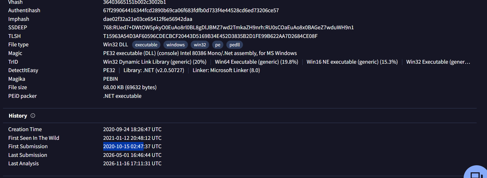

# Question 4: First Submission to VirusTotal

## Question

Understanding when the broader cybersecurity community first identified the malware could help determine how long the malware might have been in the environment before detection. When was the malware first submitted to VirusTotal?

## Finding

**2020-10-15 02:47**

## Investigation Methodology

1. Opened [VirusTotal](https://www.virustotal.com/gui/home/search).
2. Searched for the malware sample using its SHA256 hash from `hash.txt`.
3. Navigated to the **Details** tab.
4. Located the **History** section.
5. Examined the **First Submission** timestamp.
6. Recorded the date and time displayed by VirusTotal.

## Evidence

VirusTotal reports the malware sample's first submission timestamp as:

`2020-10-15 02:47`

## Tool Used

- VirusTotal

## Screenshot

Add the relevant screenshot below:

## Security Relevance

The first submission timestamp provides an indication of when the malware sample was first uploaded to VirusTotal.

Comparing this timestamp with the sample's reported creation time can help analysts establish a basic timeline for further investigation.

**Important:** First submission to VirusTotal does not necessarily represent the date the malware first appeared in the wild or entered an organization's environment.
