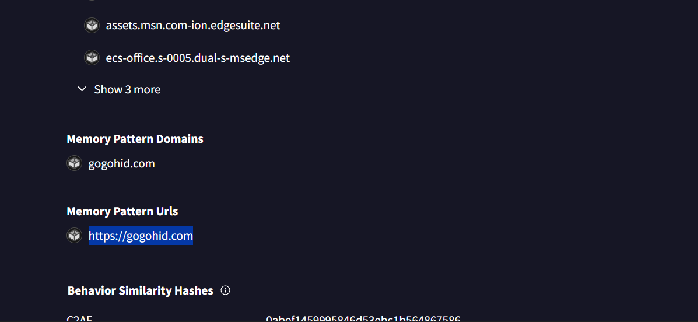

# Question 6: Command-and-Control (C2) Infrastructure Identification

## Question

It is crucial to identify the C2 servers with which the malware communicates to block its communication and prevent further data exfiltration. What is the C2 server that the malware is communicating with?

## Finding

**`https://gogohid.com`**

## Investigation Methodology

1. Opened [VirusTotal](https://www.virustotal.com/gui/home/search).
2. Searched for the malware sample using its SHA256 hash from `hash.txt`.
3. Navigated to the **Behavior** tab.
4. Reviewed the network activity and contacted domains recorded in the behavioural analysis.
5. Identified the following domain as the reported C2 server:

   `gogohid.com`

## Evidence

The VirusTotal Behavior analysis identifies the following domain:

`https://gogohid.com`

## Tool Used

- VirusTotal

## Screenshot

Add the relevant screenshot below:

## Security Relevance

Command-and-control infrastructure allows malware to communicate with attacker-controlled systems. Depending on the malware's capabilities, these communications may support remote commands, payload delivery, or data exfiltration.

Identifying suspicious domains helps incident responders develop defensive controls, including DNS filtering, web proxy blocking, and network monitoring.

A domain appearing in behavioural analysis is an indicator for further investigation. Analysts should validate the associated traffic and context before concluding that every connection represents successful C2 communication.
